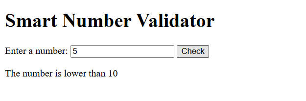
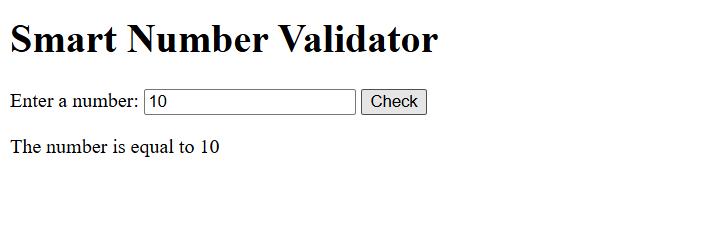
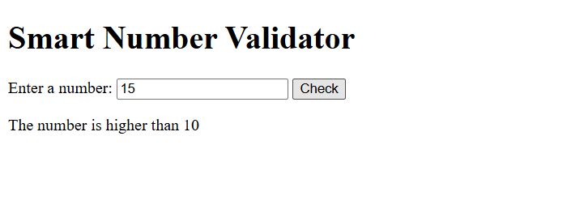
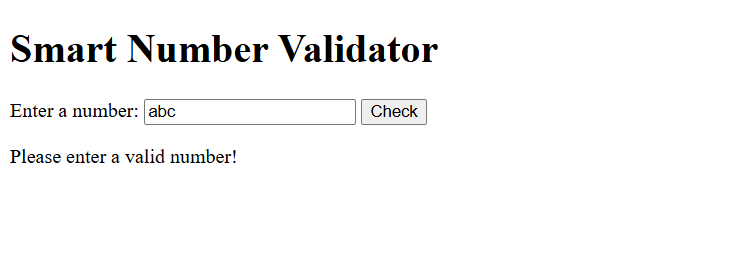
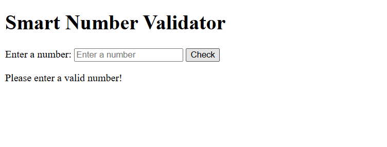
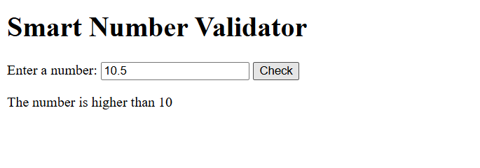
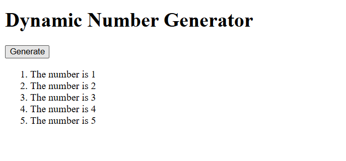
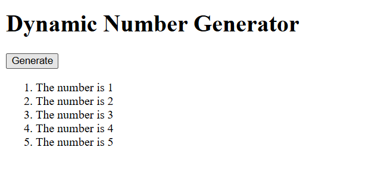

# BIC21203 Lab 4a – Client-Side Scripting (JavaScript)

## Student Information
**Name:** NUR ANISA DIANA BINTI MOHD NOORDIN  
**Student ID:** AI240061  
**Course:** BIC21203 Web Development  
**Lab:** Lab 4a – Client-Side Scripting (JavaScript)

## Brief Explanation

### Question 1: Interactive Text Changer
This question demonstrates DOM manipulation using JavaScript. The `changeMessage()` function changes the paragraph text from "Welcome to my website!" to "Hello there!" when the user clicks the button.

### Question 2: Smart Number Validator
This question demonstrates input validation using JavaScript conditional statements. The `checkInput()` function determines whether the entered number is lower than, higher than, or equal to 10. It also handles invalid and empty inputs.

### Question 3: Dynamic Number Generator
This question demonstrates the use of a JavaScript `for` loop and DOM manipulation. The `generateNumbers()` function creates a numbered list from 1 to 5 and clears existing items to prevent duplication.

## Instructions to Run

1. Download the repository or open the project files.
2. Open the folder for Question 1, Question 2, or Question 3.
3. Double-click `index.html` to open it in a web browser.
4. Follow the instructions below to test each question.

**Question 1:** Click "Change Message" to change the paragraph text.

**Question 2:** Enter a number and click "Check" to display the validation result.

**Question 3:** Click "Generate" to display a numbered list from 1 to 5.

## Screenshots of Outputs

### Question 1: Interactive Text Changer

**Before Clicking Button**

**After Clicking Button**

### Question 2: Smart Number Validator

**Input: 5 (Lower than 10)**

**Input: 10 (Equal to 10)**

**Input: 15 (Higher than 10)**

**Input: abc (Invalid Input)**

**Empty Input (Invalid Input)**

**Input: 10.5 (Decimal Number)**

### Question 3: Dynamic Number Generator

**After Clicking Generate**

**After Clicking Generate Again (No Duplicates)**

